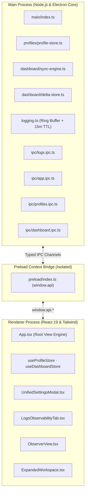

# Orbit Dashboards — System Architecture & Design

## Overview
**Orbit Dashboards** is an enterprise-grade multi-profile Slack, Teams, and Web Platform management workspace built on **Electron**, **React 19**, and **TypeScript**.

The application isolates web sessions across client workspaces, synchronizes background channel activity, provides AI-driven project analytics, and delivers real-time observability across all user interactions and IPC channels.

---

## 1. Process Architecture & Boundaries



### Security Boundaries
- **Context Isolation**: `contextIsolation: true` and `nodeIntegration: false` are strictly enforced across all renderer windows and BrowserViews.
- **Session Partitions**: Each profile operates under an independent `persist:profile_<id>` session partition. Cookies, localStorage, and authentication tokens never bleed across client accounts.
- **Token Redaction**: Tokens (`xox*`, `nvapi-*`, Bearer headers, passwords) are automatically redacted with `[REDACTED]` prior to hitting in-memory buffers, disk logs, or renderer IPC channels.

---

## 2. Core Subsystems

### 2.1 Ephemeral Observability & Logging (`src/main/logging.ts`)
- **Memory-Bounded Ring Buffer**: Holds the most recent 2,000 log events.
- **Auto-Expiry Retention**: Ephemeral time-to-live defaults to **15 minutes** (`retentionMs = 900,000`). A 30-second sweeper automatically purges stale records.
- **Granular Category Tags**:
  - `[UI]`: User clicks, modal opens/closes, theme changes.
  - `[NAV]`: Profile activations, tab selections, custom link launches.
  - `[IPC]`: Preload invoke calls and payloads.
  - `[SYNC]`: Poller ticks, delta calculations, token health checks.
  - `[AUTH]`: OAuth flows, Google verification, session refreshes.
  - `[SEC]`: App lock/unlock, token security events.
  - `[ERROR]`: Unhandled exceptions, failed promises, React error boundaries.

### 2.2 Unified Settings Hub (`UnifiedSettingsModal.tsx`)
- Single source of truth for application preferences, appearances, sidebar density, accounts, and diagnostics.
- Sidebar contains 7 unified navigation sections:
  1. 🎨 Preferences & Appearance
  2. 🎛️ Advance Control
  3. 📑 Sidebar & Navigation
  4. 🤖 Global AI & NVIDIA NIM
  5. 👥 Accounts & Workspaces
  6. 📜 Logs & Observability
  7. 🛡️ System & Maintenance

### 2.3 Background Sync & Delta Engine (`src/main/dashboard/`)
- Polls monitored Slack channels every 5 minutes (or on manual sync).
- Stores incremental message history locally in `<userData>/dashboard/`.
- Computes heuristic project completion %, sentiment indicators, and activity timelines without external cloud transmission.

---

## 3. Directory Layout

```
Orbit-Dashboards/
├── docs/
│   ├── ARCHITECTURE.md         # This document
│   └── adr/                    # Architecture Decision Records (0001-0008)
├── GLOSSARY.md                 # Shared domain terminology
├── src/
│   ├── main/                   # Electron Main Process
│   │   ├── ipc/                # Deep IPC handler modules
│   │   ├── dashboard/          # Sync engine, delta stores, token manager
│   │   ├── profiles/           # Chrome auth, session partitions, browser views
│   │   └── logging.ts          # Ephemeral ring-buffer logger & sweeper
│   ├── preload/                # Secure context bridge definitions
│   ├── renderer/src/           # React 19 UI
│   │   ├── components/         # Modals, sidebar, cards, logs hub
│   │   ├── hooks/              # Zustand state selectors
│   │   └── styles/             # Modular CSS stylesheets
│   └── shared/                 # Typed IPC contracts & interfaces
└── tests/                      # Vitest UI and unit test suites
```

